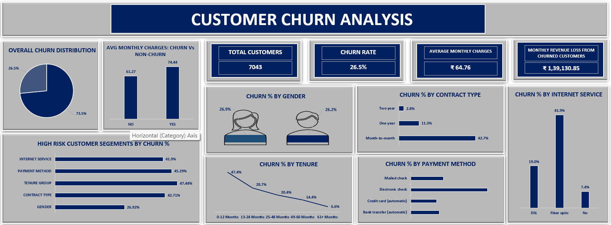

# Telco-Customer-Churn-Analysis
Excel-based analysis of telecom customer churn, identifying high-risk customer segments and retention opportunities.

# 📊 Telco Customer Churn Analysis

## 📌 Project Overview

Customer churn is a major challenge for telecom companies because losing customers can lead to revenue loss and increased customer acquisition costs.

This project analyzes customer churn using the **Telco Customer Churn dataset** to identify customer segments with higher churn rates, understand factors associated with customer attrition, and recommend strategies to improve customer retention.

The analysis was performed entirely using **Microsoft Excel**, including data cleaning, exploratory data analysis, PivotTables, formulas, visualizations, KPI calculations, and correlation analysis.

## 🎯 Business Objectives

- Analyze the overall customer churn rate.
- Identify customer segments with higher churn.
- Understand the relationship between tenure, monthly charges, and churn.
- Analyze churn patterns across contract types, payment methods, and internet services.
- Calculate important business KPIs.
- Recommend strategies to improve customer retention.

## 📂 Dataset Information

**Dataset:** Telco Customer Churn  
**Source:** [Kaggle – Telco Customer Churn Dataset](https://www.kaggle.com/datasets/blastchar/telco-customer-churn)

- Total Records: 7,043 customers
- Target Variable: Churn (Yes/No)

### Key Dataset Features

| Category | Features |
|---|---|
| Demographics | Gender, SeniorCitizen, Partner, Dependents |
| Customer Information | Tenure |
| Services | PhoneService, InternetService, OnlineSecurity, TechSupport, StreamingTV |
| Billing | MonthlyCharges, TotalCharges |
| Account Information | Contract, PaymentMethod, PaperlessBilling |
| Target | Churn |

## 🛠️ Tools & Technologies

- Microsoft Excel
- PivotTables
- Excel Formulas
- Conditional Formatting
- Charts and Visualizations
- Correlation Analysis

## 🔄 Project Workflow

### 1. Data Preprocessing
- Inspected and cleaned the dataset.
- Handled blank values in TotalCharges.
- Created a `ChurnFlag` column to convert churn values into numeric format.
- Created a `TenureGroup` column to categorize customers by tenure.
- Standardized MonthlyCharges using Z-score standardization.

### 2. Exploratory Data Analysis (EDA)

Analyzed customer churn across:

- Gender
- Contract Type
- Internet Service
- Tenure Groups
- Payment Method

### 3. Churn Analysis

- Overall Churn Distribution
- Average Monthly Charges: Churned vs Non-Churned Customers
- High-Risk Customer Segments
- Correlation Analysis

### 4. Dashboard Development

Created an interactive Excel dashboard to present key churn metrics and customer segment analysis.

## 📈 Key Performance Indicators (KPIs)

- Total Customers
- Overall Churn Rate
- Average Monthly Charges
- Monthly Revenue Loss from Churned Customers

## 🔍 Key Findings

1. **Overall Churn Rate:** 26.5% of customers have churned.
2. **Customer Tenure:** Customers with 0–12 months of tenure have the highest observed churn rate at 47.44%.
3. **Tenure Relationship:** Tenure has a negative correlation of -0.3522 with churn.
4. **Monthly Charges:** MonthlyCharges has a positive correlation of 0.1934 with churn.
5. **Contract Type:** Month-to-month customers represent an important high-churn segment.
6. **Internet Service:** Fiber optic customers show comparatively higher churn in the analysis.
7. **Payment Method:** Electronic check customers are an important segment to monitor for churn.

## 💡 Business Recommendations

- Improve onboarding and customer engagement during the first year.
- Encourage month-to-month customers to consider longer-term contracts through suitable incentives.
- Investigate pricing and service experience among Fiber optic customers.
- Review pricing plans for customers with higher monthly charges.
- Monitor electronic-check customers and investigate their billing experience.
- Develop targeted retention campaigns for customers belonging to multiple high-churn segments.

## ⚠️ Project Limitations

- The dataset does not contain a direct reason-for-churn field. Therefore, the analysis identifies factors associated with churn rather than confirmed causes.
- The dataset does not contain actual churn dates, so a genuine monthly churn trend could not be calculated.
- Correlation indicates association, not causation.

## 📊 Dashboard Preview

**Data Analyst Portfolio Project**

**Tools:** Microsoft Excel  
**Domain:** Telecom | Customer Analytics | Business Intelligence

---

*This project demonstrates practical skills in data cleaning, exploratory data analysis, KPI development, data visualization, and business insight generation using Microsoft Excel.*
